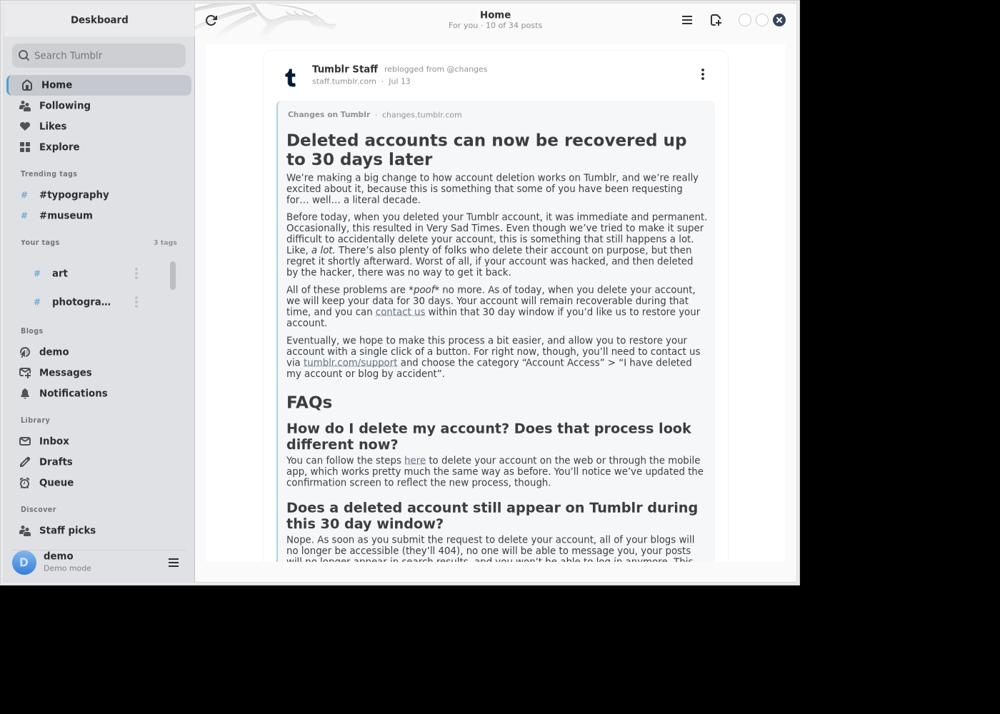
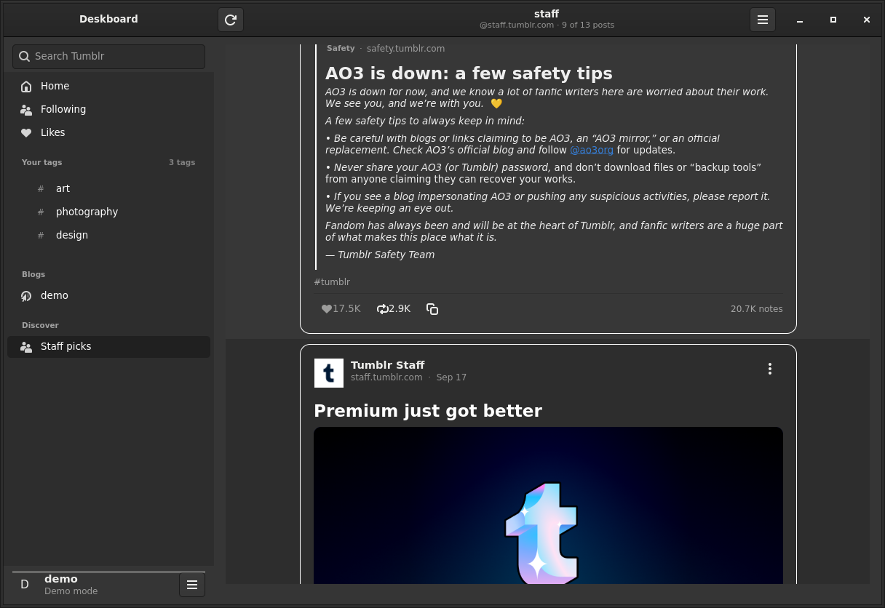
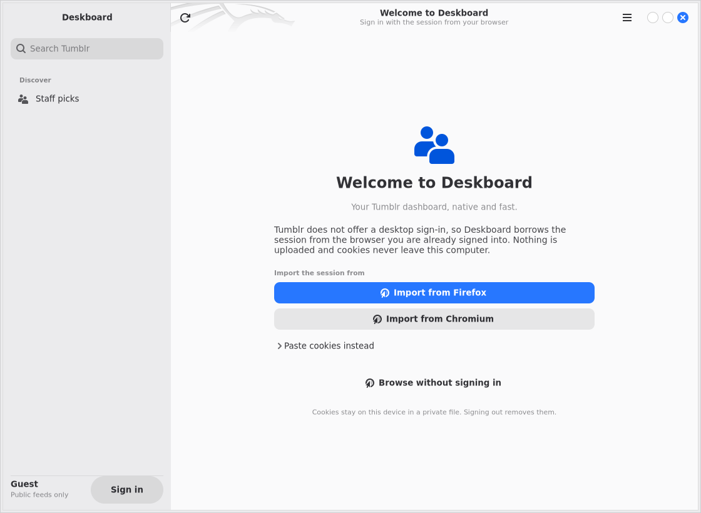

<div align="center">

> **Status: rough proof of concept.**
> Deskboard is an experimental Linux client built to answer one question — can
> Tumblr's web client be reproduced as a fast native desktop app? It works, but
> it is not production software: the API surface is Tumblr's private web API,
> it is Linux-only, and the code is a prototype. It is expected to be **rewritten
> in a better cross-platform language** and released for **Windows and macOS**.
> Treat this repository as a proof of concept and a specification of what the
> rewrite should do, not as a supported product.


# Deskboard

**A fast, native Tumblr dashboard for Linux — GTK 4 + libadwaita, no Electron, no webview.**

</div>

Deskboard is a desktop client for Tumblr's dashboard, likes, blogs, tag pages and
search. It is a normal Python/GTK application: one process, native widgets,
native scrolling, system fonts and light/dark themes. There is no embedded
browser, no JavaScript bundle and no telemetry.

## Why another Tumblr client?

- **Native, not a website in a frame.** GTK 4 + libadwaita widgets, Pango text,
  Gdk textures, libadwaita dialogs — it looks and behaves like the rest of your
  desktop.
- **Fast and small.** A few thousand lines of Python, no web runtime, no
  background service. The feed uses `Gtk.ListView` recycling, so scrolling a
  long dashboard stays smooth.
- **Offline-friendly development.** `--demo` renders captured public payloads
  with no session and no network, which makes screenshots and UI work easy.
- **Your session stays yours.** Cookies are imported from your own browser,
  stored `0600` on your machine, and only sent to `www.tumblr.com`.

## Features

- **Home ("For you") and Following** tabs — both of the dashboard tabs Tumblr's
  own web client exposes — plus likes, blog feeds, tag pages and search in one
  window.
- NPF (Neue Post Format) rendering: paragraphs, headings, quotes, chat, ordered
  and unordered lists, bold/italic/strikethrough links and mentions.
- Image grids and galleries with largest-rendition selection, HiDPI upscaling,
  animated GIF playback (when `ffmpeg` is installed), video posters/players and
  audio players.
- Reblog trails with sensible collapsing ("N earlier reblogs"), avatars, tags,
  relative timestamps and note/like/reblog counts.
- **Stale-install detection**: `--doctor` compares the running copy against the
  checkout it was installed from and tells you to reinstall if they drift.
- **Pipelined pagination**: Tumblr serves only ~4 posts per request at
  0.6–1.2 s each, so Deskboard keeps a couple of pages buffered ahead of the
  viewport instead of stalling at the bottom of the feed.
- **Your tags** section in the sidebar listing *every* tag you follow (paged to
  the server's count, scrollable), each with Open Latest / Open Top.
- **Tag pages with a Latest | Top switch** — the toggle sends the same request
  the website does (`/v2/hubs/{tag}/timeline?sort=top`); where Tumblr returns an
  identical set for both, Top additionally orders by note count.
- Empty/error states and retry everywhere — every network failure becomes an
  inline message, never a traceback in the window.
- Like, reblog (with text / post-only / scheduled), follow, reply, **send asks**
  and **submit posts**, plus message requests and notifications follow-back —
  all with optimistic UI and rollback when Tumblr refuses.
- Firefox, Chromium-family, Netscape `cookies.txt`, JSON and pasted-header
  session import; guest browsing for public blogs, tags and search. If Tumblr
  rotates your session cookie, Deskboard re-reads it from the browser once and
  retries instead of throwing you back to the sign-in page.
- Light and dark themes, compact mode, NSFW blur and window-state persistence.
- Keyboard-first navigation.
- `--demo` offline mode and `--doctor` environment diagnostics.

The full endpoint inventory, feature matrix and verification log live in
[`docs/COVERAGE.md`](docs/COVERAGE.md).

## Screenshots

Captured from the offline demo (`deskboard --demo`) — real widgets, real
typography, bundled public sample posts.

| Home, light | Post, dark |
| --- | --- |
|  |  |

## Roadmap

This repository is a **proof of concept** and is not the final form of the
project.

- **Rewrite in a cross-platform language.** The current code is Python +
  PyGObject and therefore tied to Linux/GTK. The plan is a rewrite in a language
  with a mature cross-platform UI/runtime story so one codebase can target
  Windows, macOS and Linux with native-feeling performance.
- **Windows and macOS releases.** The rewrite targets all three desktop
  platforms; this PoC only ever claimed Linux.
- **What this code is good for.** It documents the API surface
  ([`docs/COVERAGE.md`](docs/COVERAGE.md)): endpoints, payload shapes, write-auth
  (session cookies + CSRF token from the dashboard bootstrap), pagination
  behaviour, and the UX decisions (trails, media, composer, queue). That is the
  specification the rewrite should follow.
- **Not planned here:** continued feature work on the Python/GTK codebase.

## Requirements

- Linux (X11 or Wayland) with GTK 4 and libadwaita.
- Python 3.10 or newer.
- PyGObject (`python3-gi`) and the GTK 4 / libadwaita / Graphene typelibs.
- Optional: `ffmpeg` for animated GIF → MP4 playback.

No Python packages are required at runtime; the app uses only the standard
library and PyGObject. `pytest` is only needed for development.

## Install

### The short version

```bash
cd /path/to/deskboard     # a checkout of this repository

./scripts/bootstrap-gir.sh   # only if GTK 4 typelibs are missing; safe to rerun
./scripts/install.sh         # user-level install into ~/.local, no root
deskboard --doctor
deskboard
```

`install.sh` puts the application in
`${XDG_DATA_HOME:-~/.local/share}/deskboard`, creates
`~/.local/bin/deskboard`, and installs the desktop entry and icon. If
`~/.local/bin` is not on your `PATH`, the installer prints the one line to add.

To try it straight from the checkout instead:

```bash
. scripts/env.sh
python3 -m deskboard --demo    # offline, captured sample data
python3 -m deskboard           # real client, existing browser session if found
```

`scripts/run.sh` does the same and can be symlinked from anywhere:

```bash
ln -s "$PWD/scripts/run.sh" ~/.local/bin/deskboard
```

### If your distro ships the typelibs

Use the normal packages and skip the bootstrap:

```bash
# Debian / Ubuntu / Kali
sudo apt install python3-gi gir1.2-gtk-4.0 gir1.2-adw-1 gir1.2-graphene-1.0

# Fedora
sudo dnf install python3-gobject gtk4 libadwaita graphene

# Arch
sudo pacman -S python-gobject gtk4 libadwaita graphene
```

On distributions that ship `libgtk-4` but omit the PyGObject typelibs (Kali is
one), `scripts/bootstrap-gir.sh` downloads the Debian `gir1.2-*` packages,
unpacks them with `dpkg-deb -x` and keeps the typelibs under
`~/.local/share/deskboard/gir`. It does not call `sudo` and is idempotent:
if GTK 4 already imports, it exits immediately. The installed launcher and
`scripts/run.sh` activate that bundle automatically; for a manual shell use:

```bash
. scripts/env.sh
```

## Security and privacy

- **No credentials are stored in this repository.** Tumblr's public web token is
  fetched from the site on first launch and cached locally with mode `0600`
  (`~/.config/deskboard/api_token`). Your session cookies live only in
  `~/.local/share/deskboard/cookies.json`, also `0600`, never in git.
- **No telemetry.** The app talks only to `www.tumblr.com` and Tumblr's
  image/video CDNs. Nothing is sent anywhere else.
- **Writes** use the account's own session plus the per-session CSRF token; the
  client never fabricates credentials.
- See [`SECURITY.md`](SECURITY.md) for reporting and the full data-handling note.

## Signing in

Tumblr does not offer public OAuth application registration for third-party
clients, so there is no API key to request. Deskboard therefore uses the same
internal web API that tumblr.com itself uses, with **your own browser session**:
the cookies from a browser where you are already signed in. There is no
password prompt, no scraping of pages, and no account data is uploaded anywhere.

<p align="center">
  
</p>

Choose one of these:

1. **Firefox** — open Deskboard's sign-in page and choose "Import from Firefox".
   Deskboard reads `cookies.sqlite` from the Firefox profile (a copy is opened;
   the browser's lock does not matter).
2. **Chromium / Chrome / Brave / Vivaldi / Edge** — choose the matching import
   button. Chromium's cookie store is encrypted; if your desktop keyring blocks
   it, use the paste route instead.
3. **Paste a `Cookie:` header** — with tumblr.com open and signed in, open the
   browser developer tools → **Network** → reload → click a `www.tumblr.com`
   request → **Headers** → copy the value of the `Cookie` request header. Paste
   it into Deskboard and import. Treat that string like a password: it grants
   access to your account.
4. **Netscape `cookies.txt` or JSON export** — extensions such as "Get
   cookies.txt" can export the browser's cookies; import the file directly:
   ```bash
   deskboard --import-cookies ~/Downloads/cookies.txt
   ```

Cookies are written with mode `0600` to
`${XDG_DATA_HOME:-~/.local/share}/deskboard/cookies.json`. They are never
printed, logged or sent anywhere except `https://www.tumblr.com` (and Tumblr's
image/video CDNs for the media you view). Signing out clears the store.

Without a session Deskboard still browses public blogs, tag pages and search as
a guest; the dashboard, likes, reblogs and follows need a session.

## Keyboard shortcuts

| Key | Action |
|---|---|
| `j` / `k` | Move to the next / previous post |
| `o` or `Enter` | Open the selected post |
| `l` | Like or unlike the selected post |
| `r` | Reblog the selected post |
| `/` or `Ctrl+F` | Search |
| `Ctrl+R` | Refresh the current feed |
| `Ctrl+,` | Preferences |
| `Ctrl+Q` | Quit |

## Demo mode

`deskboard --demo` loads `data/fixtures/*.json`, captured public Tumblr API
responses, and serves them through a local `DemoClient`. It exercises the same
post cards, media widgets and pagination as the real client without a session or
a network connection. This is the recommended way to evaluate the UI or to
develop against it.

## Diagnostics: `--doctor`

```bash
deskboard --doctor
```

The doctor prints a short report covering Python, PyGObject, GTK 4, libadwaita,
`GI_TYPELIB_PATH`, display availability, `ffmpeg`, the stored session, public
API reachability, the signed-in account (if any), dashboard paging and storage
directories. It exits non-zero when an actionable problem is found. Run it first
when something misbehaves.

## Uninstall

```bash
./scripts/install.sh --uninstall
```

That removes the launcher, desktop entry, icon and application files. Your
session cookies, preferences and caches are kept by default; add `--purge` to
remove those as well:

```bash
./scripts/install.sh --uninstall --purge
```

## Files and configuration

Everything is XDG-based:

| Path | Purpose |
|---|---|
| `~/.local/bin/deskboard` | Launcher wrapper created by the installer |
| `~/.local/share/deskboard/deskboard/` | Installed application |
| `~/.local/share/deskboard/data/fixtures/` | Demo data |
| `~/.local/share/deskboard/cookies.json` | Browser session, mode `0600` |
| `~/.local/share/deskboard/gir/` | Privately bootstrapped typelibs |
| `~/.config/deskboard/preferences.json` | Window state and UI preferences |
| `~/.cache/deskboard/` | Image and media cache |

`XDG_DATA_HOME`, `XDG_CONFIG_HOME`, `XDG_CACHE_HOME` and `HOME` are respected.
The `--cookies PATH` flag can point at an alternative session store.

## Architecture

```
deskboard/
  __main__.py        CLI: --demo, --doctor, --cookies, --import-cookies, --feed
  app.py             Adw.Application bootstrap, CSS, actions/accelerators
  context.py         shared AppContext: client, session, prefs, image cache, pub/sub
  config.py          constants, XDG paths, persisted preferences
  models.py          Post/Block/Media/TrailItem/Blog, NPF + legacy normalisation
  util.py            count and timestamp formatting
  demo.py            offline DemoClient over data/fixtures
  doctor.py          environment + API diagnostics
  api/
    auth.py          Firefox/Chromium/Netscape/JSON cookie import, 0600 store
    client.py        blocking Tumblr web-API client and pagination
    sources.py       dashboard / likes / blog / tagged / search feed sources
  services/
    imagecache.py    async texture loading + prefetch
    media.py         GIF→MP4 encoding, video/audio helpers
  ui/
    window.py        navigation split view, shortcuts, actions, toasts
    sidebar.py       feeds, blogs, account footer
    feed.py          Gtk.ListView feed, infinite scroll, error/empty states
    postcard.py      one post card: header, trail, content, footer actions
    blocks.py        renders NPF blocks through the GTK widget set
    mediawidgets.py  image grid, video and audio players
    viewer.py        full-window media viewer
    html.py          safe Pango markup from text + formatting ranges
    onboarding.py    cookie import / sign-in page
    settings.py      Adw.PreferencesWindow
```

The dependency direction is one-way:

```
__main__ → app → context ─┬→ api.client → models
                          ├→ api.auth
                          ├→ services.imagecache / services.media
                          └→ ui.*
```

Network calls and media decoding are blocking and run on worker threads; results
are marshalled back to the GTK main loop with `GLib.idle_add`. The UI never talks
to `urllib` directly and post text is always escaped through `ui/html.to_pango`
(never raw HTML).

## Development and tests

```bash
. scripts/env.sh
python3 -m pytest -q
```

The default suite is **headless**: it covers models, NPF/legacy parsing, media
rendition and URL handling, pagination, cookie parsing and session permissions,
formatting helpers and the demo client. It never imports `deskboard.ui`, so it
runs without a display or even a working GTK typelib bundle.

Optional GUI smoke test (imports every UI module and parses the CSS under a
throw-away X server):

```bash
. scripts/env.sh
DESKBOARD_GUI_TESTS=1 xvfb-run -a python3 -m pytest -q tests/test_gui_smoke.py
```

Useful commands:

```bash
python3 -m deskboard --version
python3 -m deskboard --doctor
python3 -m deskboard --demo
python3 -m deskboard --import-cookies cookies.txt
./scripts/run.sh --feed tagged:art    # open a specific feed
```

## Troubleshooting

| Symptom | Fix |
|---|---|
| `Namespace Gtk not available for version 4.0` | Run `./scripts/bootstrap-gir.sh`, then use `scripts/run.sh` or reinstall so the launcher gets `GI_TYPELIB_PATH`. |
| `GTK 4 / libadwaita typelibs are not available` from `run.sh` | Same as above; `--doctor` still works without GTK. |
| `Tumblr refused the request: your session has expired` | Sign in again from Settings → Account, or re-import cookies. |
| Dashboard empty but public blogs work | The dashboard requires a signed-in session; import your browser session. |
| Desktop launcher does nothing | `~/.local/bin` must be on `PATH`, or run `deskboard --doctor` from a terminal. |
| GIFs do not animate | Install `ffmpeg`; without it Deskboard shows a still frame. |
| Media does not load | Check the network; Tumblr media comes from `*.media.tumblr.com` / `assets.tumblr.com`. |

## Privacy

- Deskboard has **no telemetry**, analytics, crash reporting or ads.
- Session cookies stay on this machine, in a `0600` file, and are only sent to
  `www.tumblr.com`. They are never included in logs, error dialogs or crashes.
- Network traffic goes to Tumblr only: `www.tumblr.com` for the API and
  `*.media.tumblr.com` / `assets.tumblr.com` for the images and video you view.
  There are no third-party requests.
- The demo mode performs no network I/O at all.
- Sign out (or `install.sh --uninstall --purge`) removes the stored session.

## Disclaimer

Deskboard is an **unofficial** client. It is not affiliated with, endorsed by or
supported by Tumblr or Automattic. "Tumblr" is a trademark of its respective
owner. The app talks to Tumblr's internal web API using your own browser session;
APIs can change without notice, and using a third-party client may be subject to
Tumblr's terms of service. Use it at your own risk, and please be kind to the
service: the client makes one modest request per page and does not crawl.
